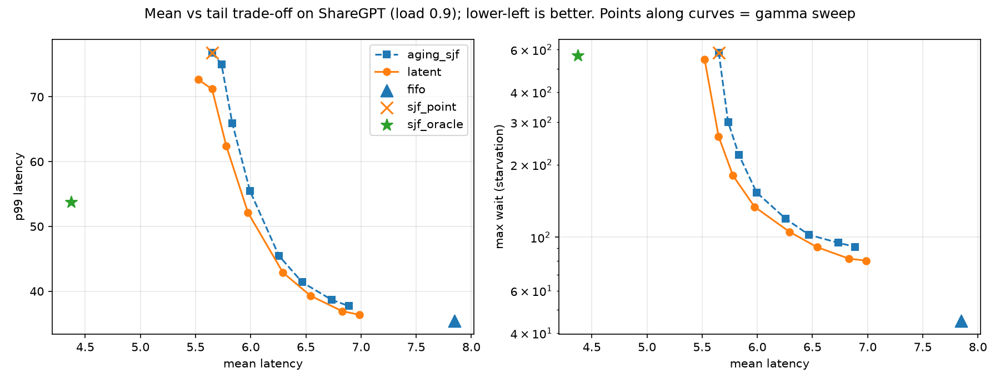
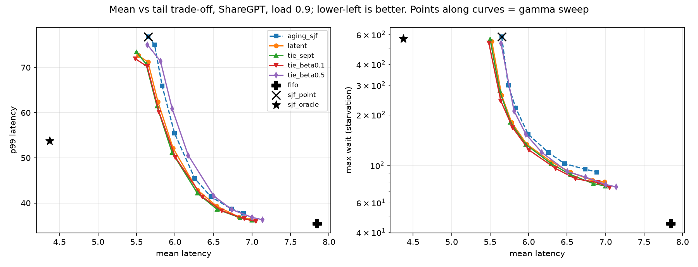

# LATENT: Uncertainty-Aware Scheduling for LLM Inference

**Question:** When an LLM server can only *predict* how long each request will take, and the predictions are noisy, how should it schedule? Does modeling prediction uncertainty beat trusting a single point estimate?

> **Status:** a controlled simulation study, not a production system, and **not a new method**. Uncertainty-aware SJF scheduling already exists (see [Related work](#related-work), especially TIE). This repo re-examines it in a controlled single-server simulator with real ShareGPT output lengths and reports where it helps, where it doesn't, and by how much.

## TL;DR

- On real ShareGPT lengths, SJF-style scheduling cuts mean and p95 latency a lot, but **hurts p99 and starvation compared with FIFO, even with a perfect oracle**.
- Ranking by expected cost under a predicted length distribution (LATENT) beats point-estimate SJF **modestly**: about 1-3% on mean and 4-6% on p99.
- A TIE-style CVaR tail term adds **no clear benefit** beyond that: a small weight is about equal to LATENT, a large weight costs mean and p95.
- With aging, LATENT-style scheduling gives about 5-6% lower p99 than aging-SJF at equal aging strength, with about 1% higher mean once aging is strong.
- (Synthetic study) If the predictor's uncertainty is badly wrong, LATENT can be worse than point-SJF; online recalibration repairs this.

Gains are small and specific to this simplified setting. Nothing here should be read as a production GPU speedup.

## Approach

A discrete-event simulator with one non-preemptive worker.

```
Workload -> Length predictor (median + sigma) -> Scheduling policy -> Simulator -> Metrics
```

- **Policies:** FIFO, oracle SJF (upper bound), point-estimate SJF, aging-SJF, **LATENT**, and a re-implementation of the **TIE** score (Zheng et al., arXiv 2604.00499).
- **LATENT:** ranks requests by the posterior expected cost `exp(mu + sigma^2/2)`, with optional aging `score = cost / (1 + gamma * wait)`. For synthetic predictors it first shrinks the prediction toward a population prior; for the learned predictor the prediction is already a conditional distribution, so no extra shrinkage is applied.
- **Workloads:** synthetic (exponential, lognormal, bimodal) and **real ShareGPT** prompts.
- **Learned predictor:** TF-IDF + ridge regression on log output length, plus a second model for per-prompt sigma, calibrated on held-out data. Held-out quality: R² = 0.44, Spearman = 0.56; reported sigma is informative (actual error std rises 0.57 -> 0.70 -> 1.03 across sigma terciles).
- **Validation:** the simulator reproduces M/M/1 theory within 5% (`tests/test_queueing.py`).
- All comparisons are paired across seeds, with 95% confidence intervals.

## Results

### 1. SJF helps mean and p95 but hurts the extreme tail (real ShareGPT lengths)
Load 0.9, service time = output tokens:

| policy | mean | p95 | p99 | max wait |
|---|---|---|---|---|
| FIFO | 7.8 | 24.2 | **35.4** | **45** |
| SJF oracle | 4.4 | 12.6 | 53.7 | 569 |
| SJF point | 5.7 | 18.0 | 76.8 | 583 |

Real output lengths are far less heavy-tailed than the synthetic lognormal workload. SJF starves long requests, so even the oracle has a worse p99 than FIFO. On the heavy-tailed synthetic workload SJF improves p99 too, so conclusions depend on the length distribution.

### 2. LATENT vs point-estimate SJF (no aging)
Paired % change, 10 seeds, 95% CI (negative = better):

| load | mean | p99 |
|---|---|---|
| 0.80 | -1.0 ± 0.3 | -3.8 ± 1.8 |
| 0.90 | -2.2 ± 0.6 | -5.3 ± 2.9 |
| 0.95 | -3.0 ± 1.2 | -5.9 ± 3.4 |

### 3. LATENT vs aging-SJF across the trade-off (load 0.9)
Paired % change at equal aging strength gamma:

| gamma | mean | p95 | p99 | max wait |
|---|---|---|---|---|
| 0 | -2.2 ± 0.6 | -1.5 ± 1.3 | -5.3 ± 2.9 | -5.9 ± 8.2 |
| 0.01 | -0.9 ± 0.2 | -1.2 ± 1.5 | -5.2 ± 2.0 | -14.2 ± 13.1 |
| 0.05 | +0.6 ± 0.3 | -2.5 ± 0.8 | -5.7 ± 1.7 | -9.4 ± 9.6 |
| 0.3 | +1.4 ± 0.1 | -1.3 ± 0.8 | -4.5 ± 0.9 | -11.7 ± 13.0 |
| 1.0 | +1.4 ± 0.1 | -0.8 ± 0.7 | -3.6 ± 1.0 | -9.7 ± 12.2 |

p99 improves at every gamma tested. Mean latency improves with weak aging and is about 1% worse with strong aging. Max-wait gains have a consistent sign but wide intervals.



### 4. Does a CVaR tail term help? (TIE-style score, load 0.9)
Re-implementation of TIE's score (expected length + beta * CVaR on a log-t, censored at max tokens). Paired % change vs LATENT, no aging:

| variant | mean | p95 | p99 |
|---|---|---|---|
| beta = 0 (expectation only) | -0.4 ± 0.3 | -1.3 ± 1.2 | +1.0 ± 2.4 |
| beta = 0.1 | -0.7 ± 0.4 | -0.8 ± 0.9 | -1.0 ± 1.8 |
| beta = 0.5 | **+2.2 ± 0.4** | **+4.6 ± 1.4** | **+3.3 ± 2.0** |

- The log-t and lognormal expectations give essentially the same schedule, which is a useful sanity check.
- A small CVaR weight is statistically indistinguishable from LATENT; a large weight costs mean and p95.
- With aging, TIE-style variants trade mean for tail and starvation, but on the full gamma sweep their curves overlap LATENT's, so the CVaR term mostly moves along the trade-off rather than improving it.
- TIE's adaptive beta depends on batch size; with a single worker (B = 1) it sits near 0.5, so the adaptive rows here are **not** a test of the paper's adaptive scheme.



### 5. Sensitivity to wrong uncertainty (synthetic)
With a calibrated synthetic predictor, LATENT improves on point-SJF by a few percent on mean and p99. If the predictor is badly underconfident or its sigma is uninformative, LATENT can be worse than point-SJF. **Online recalibration** (learning the real error scale from finished requests) fixes the harmful cases on synthetic workloads and costs nothing when the predictor is calibrated. On the real-data predictor, which was calibrated offline, recalibration brought no benefit.

### Null and negative results
- Ranking by a risk-averse quantile did not beat ranking by the posterior mean (synthetic).
- A CVaR tail term did not improve on expected-cost ranking (real data).
- Online recalibration did not help when the predictor was already calibrated.
- No policy tested beats FIFO on p99 on the real workload.

## Related work

The closest prior work is **TIE** (Zheng et al., arXiv 2604.00499): per-prompt output-length distributions, SJF on expected length plus a CVaR tail term, with starvation prevention, implemented in vLLM. Related: Chen et al. 2025 (prediction intervals, arXiv 2508.14544), MAPS (conformal length bounds), and the Mitzenmacher & Shahout survey (arXiv 2503.07545). Details and verification levels are in [`docs/related_work.md`](docs/related_work.md). This repo does not claim a new scheduling principle.

## Limitations

- **Simulation only**, one non-preemptive worker. No batching, preemption, KV cache or memory effects.
- **Service time = output tokens.** Prefill is not modeled. Token counts are approximate (characters / 4), and only the first exchange of each conversation is used.
- **Poisson arrivals**; real traffic is burstier.
- The learned predictor is deliberately simple (TF-IDF + ridge); better predictors would shift results.
- The TIE comparison is a re-implementation of the scoring rule with a different predictor and aging form, in a different setting. It says nothing about the paper's own results.
- Many policy variants were compared; confidence intervals are not corrected for multiple comparisons, and hypotheses were refined as results came in (see `docs/experiments.md`).
- Gains are modest. Do not read them as production speedups.

## Reproduce

```bash
python -m venv .venv && source .venv/bin/activate
pip install -r requirements.txt
pip install -e .
pytest -q

# synthetic experiments
python experiments/run.py     # headroom: oracle vs noisy SJF
python experiments/run2.py    # LATENT v1 vs baselines
python experiments/run3.py    # miscalibration sweep
python experiments/run4.py    # recalibration

# real data (ShareGPT; not redistributed here)
mkdir -p data
curl -L -o data/ShareGPT_V3_unfiltered_cleaned_split.json \
  https://huggingface.co/datasets/anon8231489123/ShareGPT_Vicuna_unfiltered/resolve/main/ShareGPT_V3_unfiltered_cleaned_split.json
python scripts/prepare_sharegpt.py
python scripts/train_predictor.py
python experiments/run5.py    # real-data comparison
python experiments/run6.py    # LATENT vs aging-SJF sweep + figure
python experiments/run7.py    # TIE-style score comparison
python experiments/run8.py    # trade-off figure including TIE variants
```

## Repository layout

```
latent/        library: sim/, policies/, predictor/, workload/
experiments/   run.py ... run8.py
scripts/       ShareGPT preparation and predictor training
tests/         M/M/1 validation, policy and recalibration tests
docs/          related_work.md, design.md, experiments.md, figures
```

## License
MIT